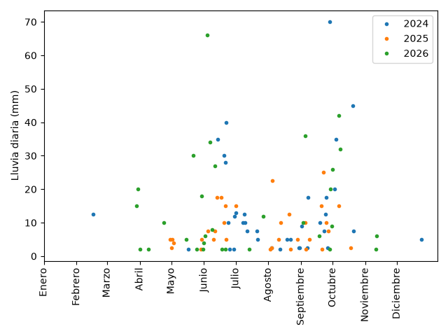
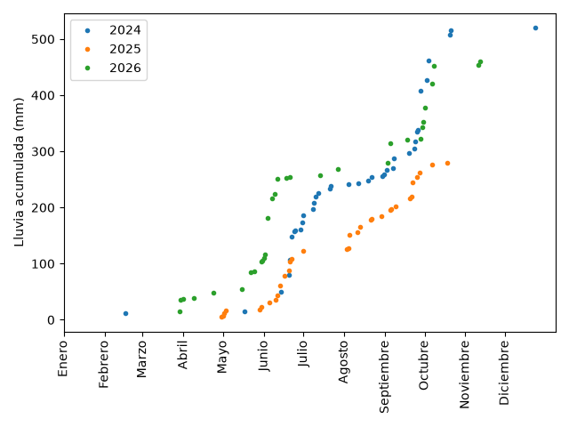

# Pitao Cocijo

Lluvia diaria y acumulada en San Pablo Villa de Mitla, Oaxaca.


## Qué hace

Muestra cómo ha llovido en San Pablo Villa de Mitla. Con dos gráficas puedes comparar los años y seguir el avance de la temporada de lluvias:

- **Lluvia diaria**: los milímetros que cayeron cada día, agrupados por año.
- **Lluvia acumulada**: la suma de la lluvia a lo largo de cada año.





## Uso

Cada color representa un año distinto. La primera gráfica muestra los días con lluvia; la segunda, cuánto se ha acumulado.

## Antes de empezar

Necesitas Docker. Si prefieres no usar Docker, necesitas Python 3.9 o superior.

## Ejecutar el proyecto

Con Docker, para regenerar las gráficas:

```
docker compose build main
docker compose run --rm main cocijo write-daily-rain-plot --data-path data/registro_lluvias.csv --output-path lluvia_diaria.png
docker compose run --rm main cocijo write-cumulative-rain-plot --data-path data/registro_lluvias.csv --output-path lluvia_acumulada.png
```

Para ver la versión web:

```
docker compose up streamlit
```

y abre <http://localhost:8501>.

Sin Docker:

```
pip install --editable .
cocijo write-daily-rain-plot --data-path data/registro_lluvias.csv --output-path lluvia_diaria.png
cocijo write-cumulative-rain-plot --data-path data/registro_lluvias.csv --output-path lluvia_acumulada.png
```
